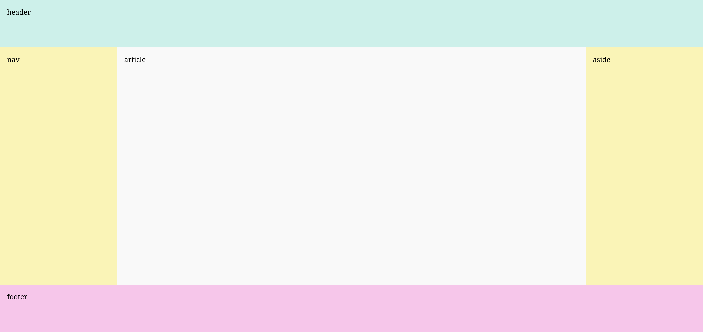
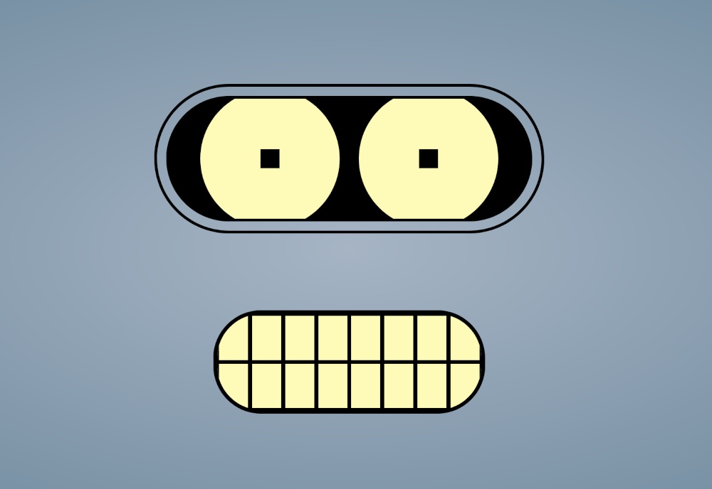
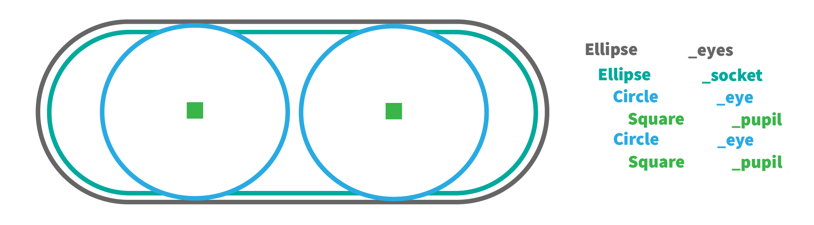
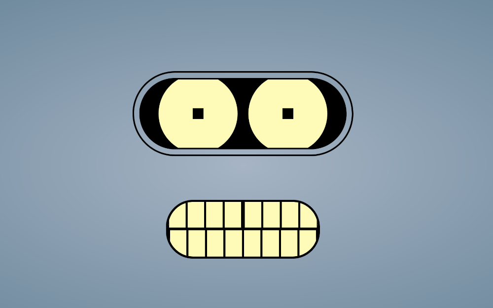

# Lab 4 - css#2

*Use the lecture notes to recall the CSS concepts used for defining the layout of a web pace (revisit the CSS properties for positioning and the layout methods flexbox and grid from lecture 4) and solve the following exercises.*  

## flexbox & grid

1. Play [Flexbox Froggy](https://flexboxfroggy.com/) and test your knowledge on the flexbox layout method.

2. Play [Grid Garden](https://cssgridgarden.com/) and test your knowledge on the grid layout method.

## page layout example

Download the files `layout.html` and `layout-style.css` from the  `resources` directory. Your main task is to modify these files. Read carefully the files and solve the exercises below, following Felonious Gru's [plan](https://github.com/cechirita/tw2627e/blob/main/Lab%204/resources/images/minion.jpg).

3. Complete the CSS rules from the file `layout-style.css`, replacing the `?` symbol with appropriate values, such that the page will look like in the image below:

4. Complete the CSS rules from the file `layout-style-flex.css`, replacing the `?` symbol with appropriate values, such that the page will look like in the image above. Which of the two methods, flexbox and grid, seems more suitable for defining this layout? 

5. [ *extra* ] Create a new CSS file `layout-style-position.css`. Add CSS rules that do not use the flexbox or grid methods, only properties such as `position`, `float`, `clear` etc., to recreate the layout from exercises 3 and 4. 

6. Use the [CSS validator](https://jigsaw.w3.org/css-validator/) to fix any possible errors or warnings for each of the CSS files you modified in the previous exercises. 

## mind the gap!

Download the files `robot.html` and `robot-style.css` from the `resources` directory. Your main task is to modify these files.

7. Complete the CSS rules from the file `robot-style.css`, replacing the `?` symbol with appropriate values, such that the robot will look like in the image below:

*Hint:
The robot is made up from simple geometrical figures. Read carefully the supplied code to understand how these figures overlap. The image below highlights the figure used to make the robot's eyes.*

8. Modify the files `robot.html` and `robot-style.css` to add a teeth [gap](https://www.nowness.com/story/willem-dafoe-grigoriy-dobrygin-mind-the-gap) to our robot, like in the image below. 

*Hint: you can add new elements in the html file.*

9. Modify the files `robot.html` and `robot-style.css` to use the grid layout method. The robot should look the same, no matter what layout method is used.

10. Use the [CSS validator](https://jigsaw.w3.org/css-validator/) to fix any possible errors or warnings. 

## EXTRA

11. Play [Flexbox Defense](http://www.flexboxdefense.com/) and test your knowledge on the flexbox layout method. Tower power!

 

