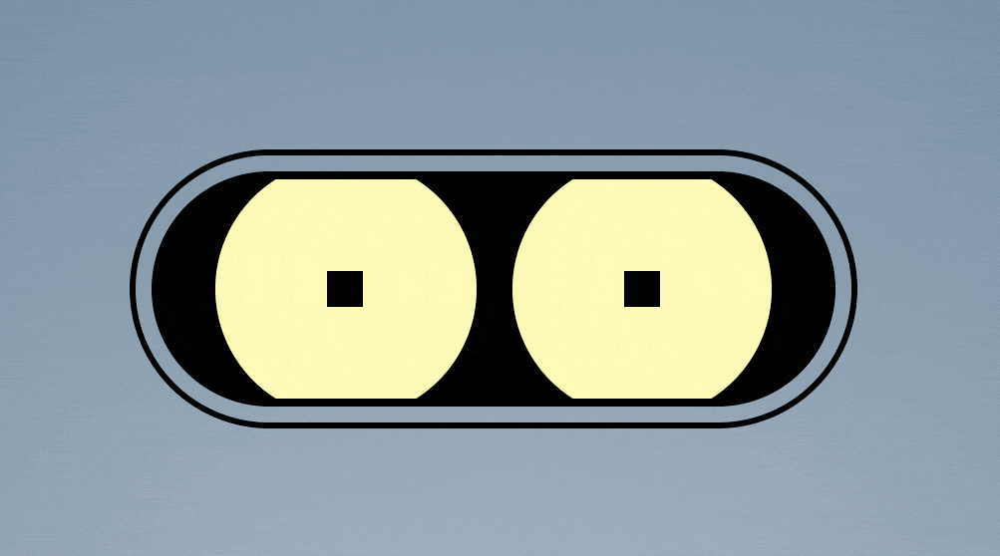
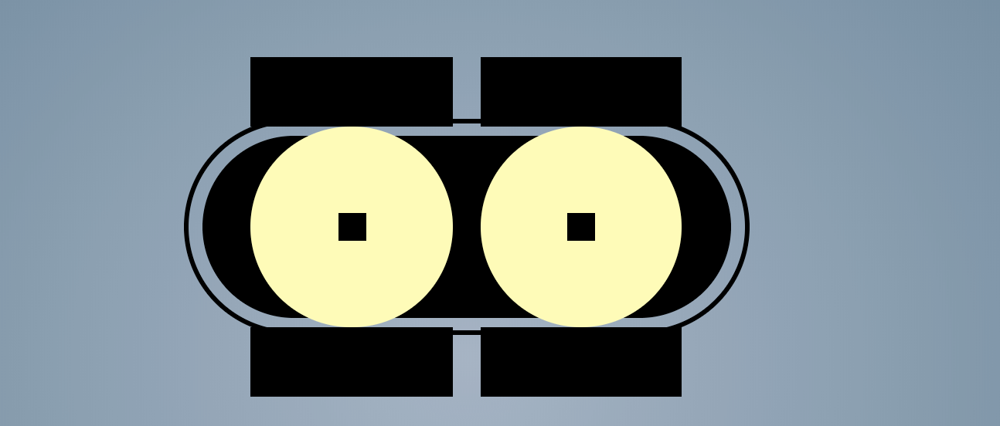
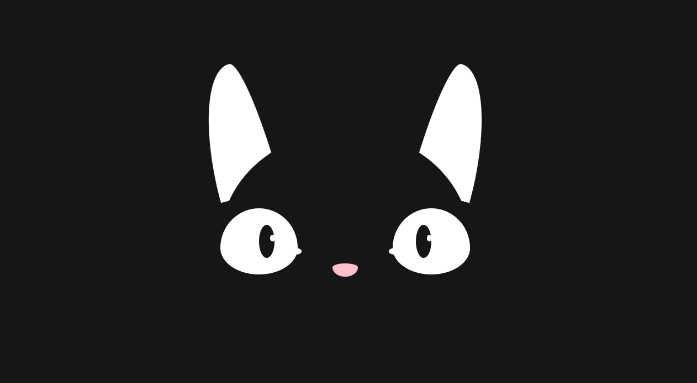
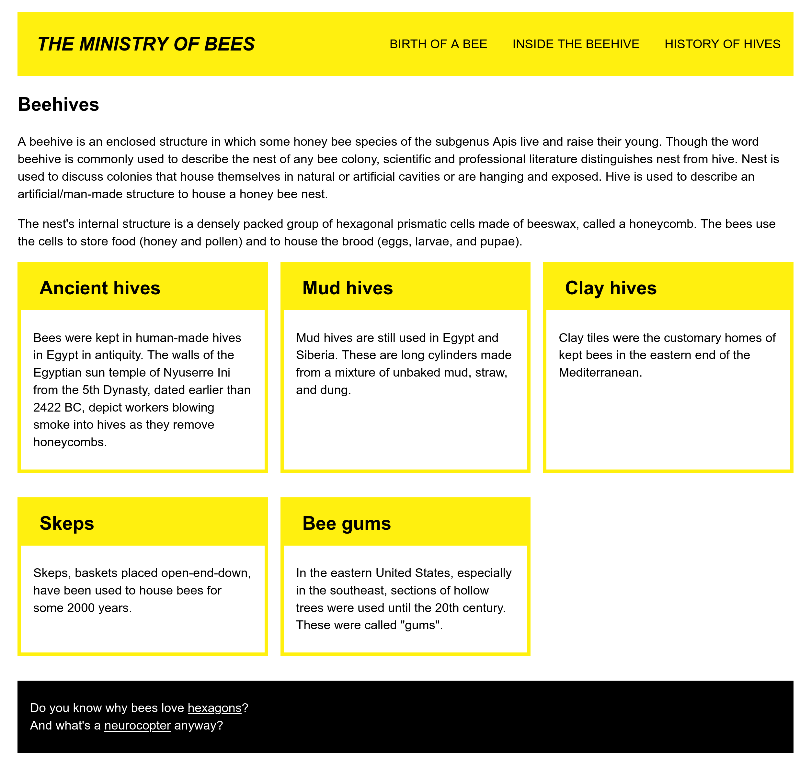
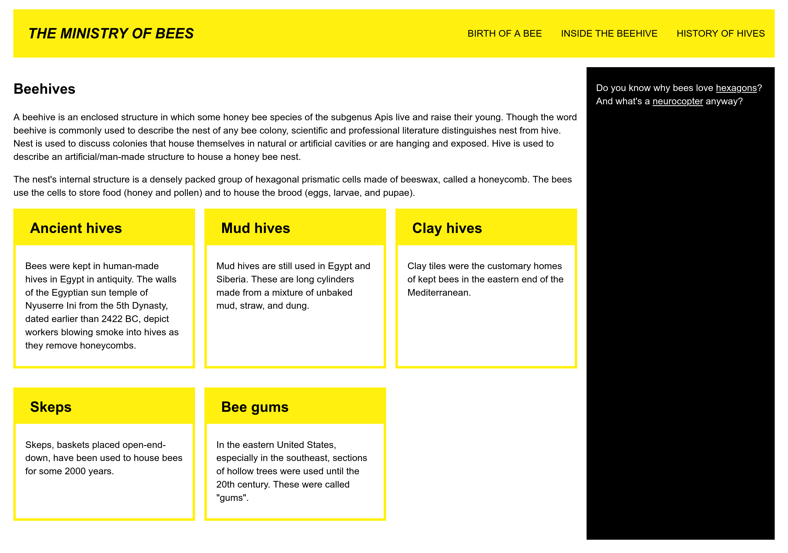
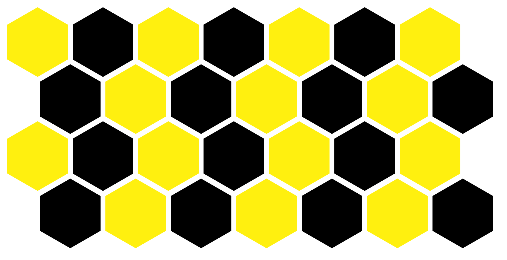
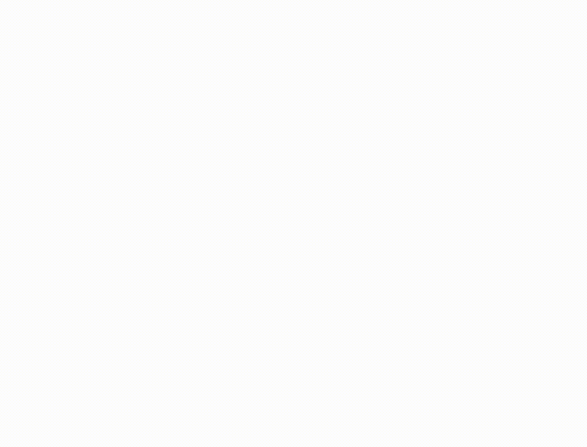

# Lab 5 - css#3

*Use the lecture notes to recall the CSS concept used to create pages with a responsive design (revisit the properties and rules for media queries), transforms, transitions and CSS animations, and solve the following exercises.*  

## "ochişorii lui, mura câmpului" [his little eyes, brambles in the field]

Download the `robot.html` and `robot-style.css` files from the  `resources` directory. Your taks is to modify the CSS file. 

1. We want to make the robot blink. More precisely, we want him to look at us with distrust, to frown. Like in the image below:

For this, we added two elements which correspond to the eyelids, using the CSS pseudo-elements `::before` and `::after`. The eyelids are positioned like the black rectangles in the image below, but they are not visible because of the `robot_socket` element. What CSS rule of this element is hiding them?

 
2. Add CSS rules for the pseudo-elements `robot_eye::before` and `robot_eye::after` such that you create two blinking animations, `topEyelid` and `bottomEyelid`. We want the animations to last 5 seconds, to start with a delay of one second, to be played in a loop, and have a smaller speed at the start and end.

3. Complete the CSS rules to define the intermediary points in the animations (keyframes) such that:
- in the first part of the animation, the robot should close the eyelids 
- then he should keep the eyelids closed between 20% and 80% of the animation duration
- he should open the eyes in the last part of the animation.  
*Hint: use the eyelids size to decide the numerical values for the translations.*

*4. (optional) Add CSS rules to create a simple animation in which the robot closes and opens its mouth.*

## Tigger, Tigger!

*Tigger Tigger, burning bright,  
In the forests of the night;  
What immortal hand or eye,   
Could frame thy fearful symmetry?    
In what distant deeps or skies.   
Burnt the fire of thine eyes?*  

Do you remember Tigger, the kitty from the first lab? Download the files `tigger.html` and `tigger-style.css` from the `resources` directory. Read carefully the CSS file and change it to solve the following exercises. 

4. Replace the ? symbols with appropriate values to complete the CSS rules from the file `tigger-style.css` such that Tigger looks like in the image above. 

5. Change the file to create two animations:
- one in which Tigger blinks twice, fast: the animations should last 4s, play in a loop, and start slower
- one in which Tigger looks around: the animation should last 4s and play in a loop.
 
## responsive design

Download the files `responsive-design.html` and `responsive-style.css` from the `resources` directory. Read carefully the files and solve the exercises below.

6. The page `responsive-design.html` has an appropriate layout for mobile devices. However, we want to also have a version of the page more suitable for larger screens.   
Complete the CSS rules in the `responsive-style.css` file, replacing the `?` symbol with appropriate values, such that the page should look like in the images below when it is loaded on screens with a width of at least 40 em, and 80em, respectively:

7. Use the [CSS validator](https://jigsaw.w3.org/css-validator/) to fix potential errors or warnings. 

## bestagons

[*Hexagons are the bestagons!*](https://www.youtube.com/watch?v=thOifuHs6eY)

8. Download the files `hexagon.html` and `hexagon-style.css` from the `resources` directory. Read carefully the files and replace the ? symbols from the `hexagon-style.css` file to draw a hexagon using the CSS property [`clip-path`](https://developer.mozilla.org/en-US/docs/Web/CSS/clip-path) and the CSS function [`polygon`](https://developer.mozilla.org/en-US/docs/Web/CSS/basic-shape/polygon).

9. Download the files `hexagon-tiles.html` and `hexagon-tiles-style.css` from the `resources` directory.Read carefully the files and replace the ? symbols from the `hexagon-tiles-style.css` file to draw a tiling of the page with hexagons like in the image below, using the flex layout method. 
 

10. Change the `hexagon-animatiles-style.css` file to create an animation like the one below in which we color hexagons by moving the mouse above them. The animation should last 4 seconds, play in a loop, with a linear speed.   
First read about the CSS property [`filter`](https://developer.mozilla.org/en-US/docs/Web/CSS/filter) and the function [`hue-rotate`](https://developer.mozilla.org/en-US/docs/Web/CSS/filter-function/hue-rotate). 

## EXTRA

11. Replace the square cards from the `responsive-design.html` page at exercise 6 with hexagons.
12. [Unfold the Box Model](https://rupl.github.io/unfold/) to review CSS transforms.
13. End of a chapter, the perfect excuse to play: play [Guess the CSS](https://www.guess-css.app/) to review the CSS concepts we studied.
14. Mid-term boredom has no chance! Play with CSS [here](https://css-challenges.com) or [here](https://cssbattle.dev/). 
 

