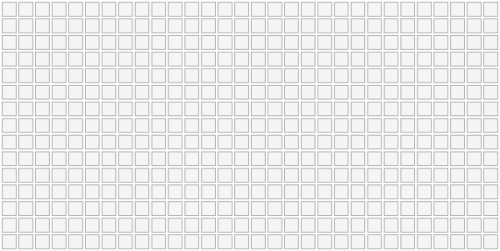
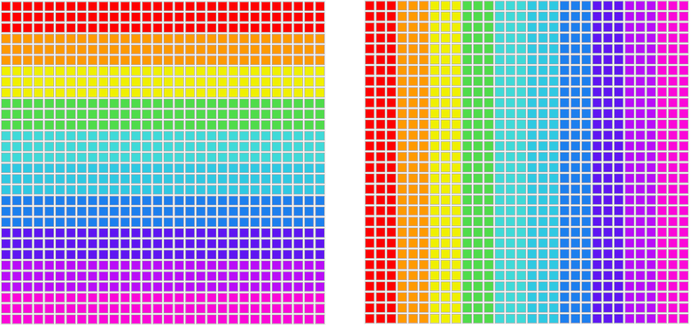
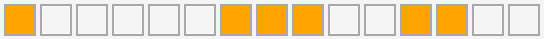

# Lab 7 - DOM

*Use the lecture notes to revise the main DOM and JavaScript concepts from [lecture 7](https://cs.unibuc.ro/~cechirita/tw/c7) and solve the following exercises.*  

## draw, draw, draw

Download the files `draw.html`, `style.css` and `draw.js` from the `resources` directory. Your main task is to modify the JavaScript file to develop a small web app for drawing. 

1. First, we will create the drawing board, like in the image below.

  
Complete the function `drawTable` to generate a table (`html` element of type `table`) of a given size (number of rows and columns) and add it to the `div` with the id `container`, using JavaScript and DOM.  

*Hint: To make the traversal of the DOM tree easier in what follows, you cana add to each `td` cell in the table a class for its row and one for its column. For example, to the first cell in the table you can add classes `"r0"` and `"c0"`.*

2. Write a function `colorCol` and a function `colorRow` that color a column, and a line, respectively from the drawing board, with a given color.

3. Use the functions above to complete the definition of the functio `rainbow` that draws a rainbow (horizontally or vertically, according to the `target` argument) like in the images below. 

  

4. Write a function `getNthChild` that returns the `n`-th (element) child of a given element.

5. Define the function `drawPixel` that colors a cell with a given color.

6. Define the function `drawLine` to draw a horizontal or vertical line between two given cells, using a given color.  
*Optional: extend the function to draw an arbitrary line, not just horizontal and vertical ones. * 

7. Define the function `drawRect` to draw a rectangle with a given  using the function `drawLine`. 

8. Extend the function `drawPixel`: if the cell at a line and column given as parameters does not exist, first resize accordingly the drawig board, adding new lines and/or columns.

9. Extend the function `drawPixel` to allow specifying the weight with which a cell will be colored with a given color: 
- if the weight is 1, then the cell will be colored using the color given as an argument
- if the weight is 0, then the cell will keep its initial color
- for any other value for the weight, the initial color and the new one will be blended. For example, if the weight is 0.5, then the initial color and the new one will be blended in equal proportions (50%).
*Hint: use colors of the form `rgb(x,x,x)` to simplify the code. The function `colorMixer` receives as arguments two integers which correspond to the values of a color channel for the two colors to be blended and an integer corresponding to the blending weight.*

10. Define the functions `delRow` and `delCol` that allow deleting a line and a column from the drawing board.  
*Hint: if you have added classes corresponding to the position of each cell from the table, don't forget to update the classes, when necessary.*

11. Define the function `shiftRow` that applies a circular permutation to the right for a given number of positions to the elements on a line of the drawing board.  
*Hint: for example, the content of the line below is shifted with 4 positions.*  
  
  
 
12. Define the function `jumble` to apply a circular permutation to the right for a random number of positions to each line of the drawing board.

## EXTRA

13. Write a function `transpose` that transforms the drawing board into its transposition. Hint: if you have added classes corresponding to the position of each cell from the table, don't forget to update the classes.

14. Write a function `flip` that reverses the order of the children of a DOM object. Use the function to *flip* the drawing board horizontally and vertically.

15. Define the function `mirror` that mirrors horizontally the drawing board: it takes the left half of the board, it flips it and copies it to the right side of the board.

16. Define the function `smear` that smudges the color of a cell to the right, in its neighbouring cells, according to a weight given as an argument. The weight with which the neighbouring cells are colored is halved with each position.  
*Hint: use the function `drawPixelAmount`.*
 

